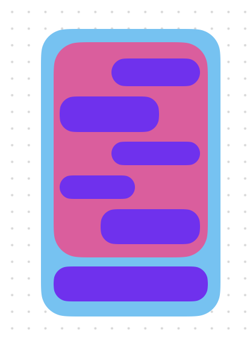

# Expedia Replica — Assignment 2 Part 2

## Project Access
Repository: https://github.com/dw477/expedia-replica

Commit:

## Research Notes
Research for this part focused on the chatbot API and its connection to the saved hotel data.

Google's [Gemini Interactions documentation](https://ai.google.dev/gemini-api/docs/interactions-overview) explains how to send questions and receive responses.

Google's [structured output documentation](https://ai.google.dev/gemini-api/docs/structured-output) explains how the answer and suggested questions can be returned together and checked before being displayed.

## Early Mockup

This is a pre-development mockup displaying the proposed chat interface popup. This layout was used in the final iteration.

## Screen-recorded Demo Video

## Verification Record
Saving a hotel was expected to preserve it across sessions, prevent duplicates, and display October 10–14, 2026, at $100.00 with 20 rooms per night. Removing it was expected to remove its saved information. Recorded checks confirmed these results and successful list/map selection.

The question “Cheapest hotel in ZIP 02108 on October 10, 2026?” was expected to identify Cheap at $100.00 with 20 rooms. The reply matched those values and labeled them classroom data. Follow-up questions, retry, and reset also passed their checks.

A live search successfully displayed hotels in the list and map. The live Gemini response matched the saved hotel prices and room counts. Both checks performed as expected.

## AI Disclosure and Evidence Log
OpenAI's GPT-6.1 Sol model was used through Codex to generate code for this part. It was the only model used for development. The website's chatbot uses Google's Gemini API with `gemini-3.8-flash` as its default model.